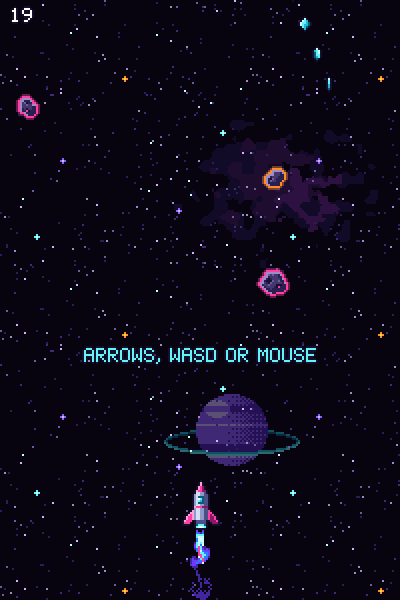
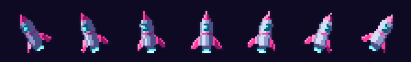
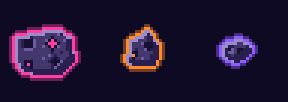
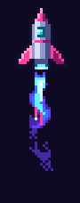
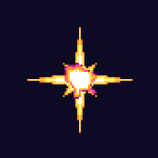

# Neon Voyage

**[Play Neon Voyage in your browser](https://skulitom.github.io/NeonRocketGame/)**: a free pixel-art rocket game for phones, tablets and computers. No download, no account.

<a href="https://skulitom.github.io/NeonRocketGame/"></a>

Fly a small, quick neon rocket side to side through an endless asteroid field. It leans into every turn and breaks apart when it hits. Graze rocks for points and a bigger multiplier, collect lines of shards, and grab shields, boosts and novas. The asteroids knock each other about, and every so often a meteor storm rolls in.

## Controls

| Device | Steer | Other |
| --- | --- | --- |
| Computer | Left and right arrows, or A and D | Any key plays again after a crash; P or Esc pauses, M turns sound off and on |
| Phone or tablet | Hold the left or right side of the screen | Tap to play again; pause and sound buttons in the corner |
| Gamepad | Left stick or d-pad, left and right | A starts, Start pauses |

## Made with Pixelbolt

Every sprite, effect and letter is a [Pixelbolt](https://github.com/skulitom/Pixelbolt) recipe in [`art/`](art/), written by an AI agent that inspected each render and fixed it, the way Pixelbolt is meant to be used. [`art/build.mjs`](art/build.mjs) turns them into the atlases in `assets/`.

| | |
| --- | --- |
|  | **Rocket** ([rocket.poses.json](art/rocket.poses.json)): a palette grid in five roll frames, tilted up to 30 degrees by RotSprite rotation, each with its turned nozzle point. Its crash pieces (nose, cockpit, tail, fins) are cut from the same grid and spun through 16 angles. |
|  | **Asteroids** ([rocks.poses.json](art/rocks.poses.json)): three rock bodies turned through 16 angles by RotSprite rotation, then lit from a fixed light with a neon edge and glow. Three colours are copies with the neon remapped. |
|  | **Exhaust** ([exhaust.fluid.json](art/exhaust.fluid.json)): a fluid simulation the game runs live with Pixelbolt's `createLiveFluid`. Steering stirs the gas and a boost flares it. This GIF is the baked loop the game shows until the solver has loaded. |
|  | **Effects** ([boom.fx.json](art/boom.fx.json), [bursts.fx.json](art/bursts.fx.json), [shield.fx.json](art/shield.fx.json), [nova.fx.json](art/nova.fx.json)): particles and shapes (shock rings, impact stars, fireballs, tumbling debris, a boiling shield bubble). |
|    | **Power-ups** ([items.json](art/items.json)): one ring and three icons, recoloured with `remap` and pulsing by palette cycling. |

The starfield ([stars.json](art/stars.json)) is noise dithering with twinkling by colour remaps, the planet and nebulae ([space.json](art/space.json)) use ramp shading and value-noise dither, the score and messages use Pixelbolt's built-in pixel font, the logo ([logo.json](art/logo.json)) is that font with neon outlines, and the link preview image is a Pixelbolt scene ([og.scene.json](art/og.scene.json)). The page draws everything with Pixelbolt's atlas runtime ([`vendor/pixelbolt/runtime.js`](vendor/pixelbolt/runtime.js)).

### Rebuilding the art

The art was built with Pixelbolt at commit [`6670597`](https://github.com/skulitom/Pixelbolt/commit/6670597). With Node.js 20 or newer:

```sh
git clone https://github.com/skulitom/Pixelbolt.git ../Pixelbolt
git -C ../Pixelbolt checkout 6670597
node art/build.mjs --pixelbolt ../Pixelbolt
```

The build is deterministic: the same sources and commit give the same bytes. It also copies the Pixelbolt modules the page runs (the fluid solver and the atlas runtime, MIT licensed) into `vendor/pixelbolt/`. Add `--keep <folder>` to write each compiled recipe there, to inspect with `pixelbolt inspect`.

## Running locally

The page uses ES modules, so serve the folder over HTTP rather than opening the file:

```sh
python -m http.server 8000
```

Then open <http://localhost:8000/>. On a local server, `window.neonVoyage.advance(ms)` steps the game without animation frames, for automated checks.

## Project layout

- `index.html`, `css/`, `js/`: the page and the game (`game.js` rules and drawing, `input.js` keyboard, mouse, touch and gamepad, `exhaust.js` the live plume, `audio.js` synthesised sound and music).
- `art/`: Pixelbolt recipes and sources, the brief, and the build.
- `assets/`, `media/`: built atlases, icons and images. Don't edit them by hand; change the recipe and rebuild.
- `vendor/pixelbolt/`: Pixelbolt's runtime and fluid modules, copied by the build.

## History

The first Neon Voyage (2024) drew its rocket and asteroids with canvas shapes. It was remade in November 2026 with Pixelbolt art, touch and gamepad controls, grazing and multipliers, power-ups that work as described, a pause, synthesised sound, and a page that scales by whole pixels on any screen.

## Licence

[MIT](LICENSE). Pixelbolt's files in `vendor/pixelbolt/` keep their own [MIT licence](vendor/pixelbolt/LICENSE).
